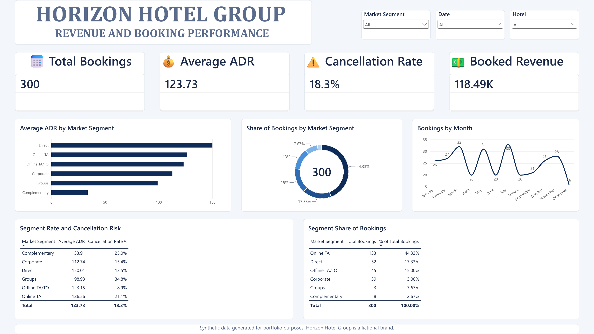
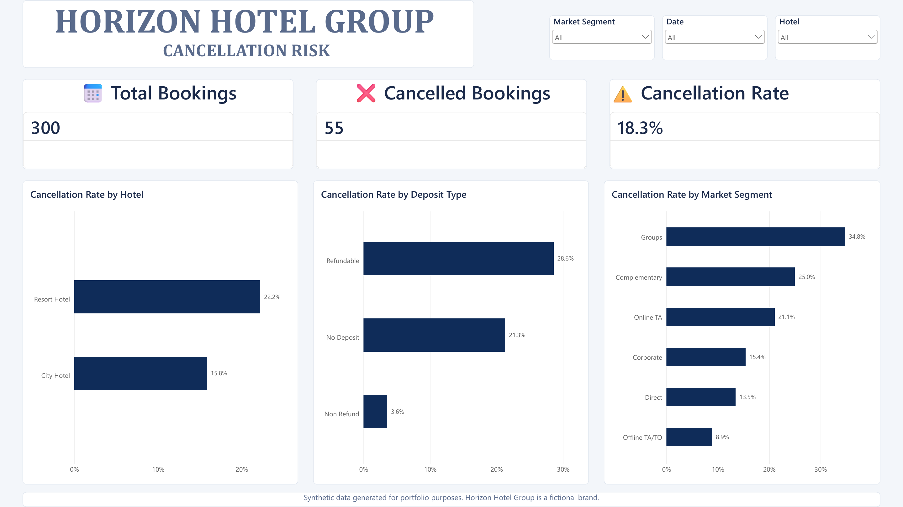

# Hotel Revenue & Booking Performance Dashboard

An end-to-end analytics project for a fictional hotel group, **Horizon Hotel Group**, with two properties: **City Hotel** and **Resort Hotel**. A SQL Server database and analytical T-SQL queries feed a two-page Power BI report on rate (ADR), booking volume and cancellation risk.




## Note on the data

The dataset is **synthetic**: 300 booking records generated for this portfolio project, following the column structure of public hotel-booking data. Patterns such as rates by channel and cancellation behaviour were built into the generator. The findings below therefore demonstrate the **analysis method**, not discoveries about real hotels. Swapping in a real dataset is the first item under Next steps.

## Business questions

1. Which booking channels earn the highest average daily rate (ADR)?
2. Which channels, properties and deposit types carry the most cancellation risk?
3. How is booking volume spread across segments and months?

## Tools

SQL Server and SSMS (T-SQL) · Power BI Desktop · DAX · custom Power BI theme (JSON)

## What I did

1. **Database setup.** Created a `HotelAnalytics` database and a typed `hotel_bookings` table, then loaded the data (`sql/01_setup_hotel_bookings.sql`).
2. **SQL analysis.** Wrote aggregate, `GROUP BY`, `CASE WHEN` and window-function queries for ADR, volume, share of bookings and cancellation rate (`sql/02_analysis_queries.sql`).
3. **Data model.** Connected Power BI to SQL Server in Import mode and wrote six DAX measures (`docs/dax_measures.md`).
4. **Validation.** Checked each DAX measure against the SQL result for the same question. This caught a type bug: `is_canceled` is a SQL `BIT`, which Power BI imports as True/False, so the filter had to be `= TRUE()` instead of `= 1`. The same `BIT` type also stops `AVG()` working in SQL Server without a cast.
5. **Report design.** Built two pages with a custom navy theme (`powerbi/horizon_hotel_theme.json`):
   - **Executive Overview:** four KPI cards (total bookings, average ADR, cancellation rate, booked revenue), average ADR by market segment, share of bookings by segment, bookings by month, two segment tables, and slicers for market segment, date and hotel.
   - **Cancellation Risk:** three KPI cards (total bookings, cancelled bookings, cancellation rate) and cancellation rate by hotel, by deposit type and by market segment.
   - The slicers are synced across both pages, and each page carries a note that the data is synthetic.

## Findings (in this synthetic sample)

Overall: **300 bookings, average ADR 123.73, cancellation rate 18.3%** (55 cancelled bookings).

| Market segment | Bookings | Share | Avg ADR | Cancellation rate |
|---|---|---|---|---|
| Direct | 52 | 17.33% | 150.01 | 13.5% |
| Online TA | 133 | 44.33% | 126.56 | 21.1% |
| Offline TA/TO | 45 | 15.00% | 123.15 | 8.9% |
| Corporate | 39 | 13.00% | 112.74 | 15.4% |
| Groups | 23 | 7.67% | 98.93 | 34.8% |
| Complementary | 8 | 2.67% | 33.91 | 25.0% |

- **Direct** bookings earn the highest ADR, about 21% above the overall average.
- **Groups** pair an ADR about 20% below average with the highest cancellation rate, 34.8%.
- **Online TA** is the largest channel at 44% of bookings, with a cancellation rate above average (21.1%).
- **Resort Hotel** has both a higher ADR than City Hotel (145.49 vs 109.81) and a higher cancellation rate (22.2% vs 15.8%).
- **By deposit type:** Refundable 28.6% (14 bookings), No Deposit 21.3% (230), Non Refund 3.6% (56). This pattern was built into the generator, so it is the first result to re-test on real data.
- Booked revenue is 118,487.50. Revenue on cancelled bookings is 22,656.29 (19.1%), leaving 95,831.21 after cancellations. See the limitation below.

## Limitations

- **Synthetic data**, so every finding is illustrative.
- **Small samples.** Groups rests on 23 bookings, Complementary on 8 and Refundable on 14, so those rates are unstable.
- **The revenue card shows booked revenue.** The underlying measure (Total Revenue) includes cancelled bookings, so the card is labelled "Booked Revenue". A net-revenue measure is described in `docs/dax_measures.md`.
- **No room inventory**, so RevPAR and occupancy cannot be calculated. ADR is the rate metric.
- **Monthly pattern is noise.** Months are pooled across 2024 and 2025, and the swings come from random date generation, not seasonality.
- **One flat table.** There is no star schema and no dedicated date table, so there are no period-over-period measures yet.

## Repository structure

```
hotel-revenue-analytics/
├── README.md
├── sql/
│   ├── 01_setup_hotel_bookings.sql    create database, table, load 300 rows
│   └── 02_analysis_queries.sql        analysis and validation queries
├── powerbi/
│   ├── Hotel_Analysis.pbix            the report (Import mode, data included)
│   └── horizon_hotel_theme.json       custom theme
├── docs/
│   ├── dax_measures.md                measures and design notes
│   └── data_dictionary.md             column definitions
└── screenshots/
    ├── executive_overview.png
    └── cancellation_risk.png
```

## How to reproduce

1. In SSMS, run `sql/01_setup_hotel_bookings.sql`. It creates the database and loads the data, and is safe to re-run.
2. Run the queries in `sql/02_analysis_queries.sql` one at a time and compare each with the expected values in the comments.
3. Open `powerbi/Hotel_Analysis.pbix` in Power BI Desktop. The data is stored inside the file, so the report opens and works without SQL Server.
4. To refresh from your own SQL Server, go to Home → Transform data → Data source settings → Change Source, and replace the server name with yours. The file was built against a local instance.
5. To reuse the look, import `horizon_hotel_theme.json` through View → Themes → Browse for themes.

## Next steps

- Replace the synthetic data with a real public hotel-bookings dataset and re-run the analysis.
- Rebuild the model as a star schema with a date table, then add period-over-period measures with DAX time intelligence.
- Add a net-revenue measure and publish the report to the Power BI Service.
